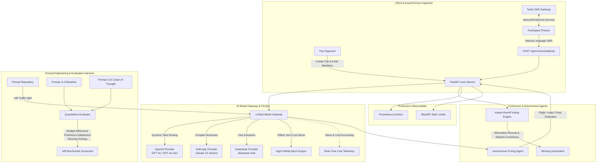

# 🧭 Itera — Autonomous Group Travel Consensus Engine

<div align="center">

[](https://github.com/Adityaslas09/itera/actions)
[](https://www.python.org/downloads/)
[](https://fastapi.tiangolo.com)
[](https://github.com)
[](http://localhost:8000/metrics)
[](https://opensource.org/licenses/MIT)

**An end-to-end, production-grade group travel platform that coordinates asynchronous SMS surveys via Twilio, routes reasoning tasks across a unified Multi-Model Gateway, benchmarks prompts using automated quantitative evaluations, and achieves mathematical group consensus via Ranked-Choice Voting (IRV).**

[Live Web Demo](#-quickstart-in-60-seconds) · [System Architecture](#-system-architecture) · [AI Engineering Highlights](#-key-ai-engineering-highlights) · [API Docs](#-api-reference)

</div>

---

## 📌 Problem & Motivation

Planning group trips is notoriously frustrating: conflicting dates, asymmetrical budgets, divergent activity preferences, and fragmented group chats regularly lead to decision paralysis. 

**Itera** (from the Latin root *iter*, meaning journey or voyage) solves this end-to-end:
1. **Low-Friction Data Collection:** Trip members don't need to create accounts or download apps—they simply reply to an automated **Twilio SMS** survey with natural language.
2. **Intelligent Preference Extraction:** Natural language SMS replies are parsed into structured schemas with constraint bounds.
3. **Multi-Model Recommendation Synthesis:** A unified **AI Model Gateway** routes tasks across OpenAI, Anthropic, or DeepSeek depending on cost and reasoning requirements.
4. **Autonomous Pricing Intelligence:** A pricing agent scans real-time flight, lodging, and activity expenses.
5. **Mathematical Group Consensus:** Instead of endless debates, participants cast ranked ballots, and an **Instant-Runoff Voting (IRV)** algorithm deterministically selects the optimal destination.

---

## 🏛️ System Architecture



---

## 🚀 Key AI Engineering Highlights

### 1. Unified Multi-Model Gateway (`backend/app/gateway/`)
Instead of coupling business logic to a single proprietary SDK, Itera implements an abstract provider interface (`BaseLLMProvider`) supporting **OpenAI**, **Anthropic**, and **DeepSeek**, alongside a high-fidelity **Mock Provider** for zero-cost local evaluation.
* **Task-Based Routing:** Routes cheap extraction jobs (`survey_extraction`) to high-throughput models and complex trade-off balancing (`recommendation_synthesis`) to frontier reasoning models.
* **Resilience & Fallback:** Automatically degrades gracefully to secondary models or offline mock engines if credentials or provider outages occur.
* **Real-time Cost Attribution:** Computes per-token inference cost in USD based on current token pricing tiers.

### 2. Versioned Prompt Repository & Automated A/B Testing (`backend/app/prompts/`)
* **Prompt Versioning:** Tracks iterations from naive baseline prompts (`v1.0-baseline`) to structured reasoning few-shot prompts with strict negative constraints (`v2.0-reasoning-constraints`).
* **Automated A/B Traffic Routing:** Configurable weighted traffic distribution across prompt variants with real-time performance tracking.

### 3. Quantitative Evaluation Harness (`backend/app/evals/`)
Recommendations are scored automatically against synthetic or human-provided benchmarks:
* **Budget Adherence Score (0.0 - 1.0):** Verifies that proposed destinations respect individual and group budget ceilings.
* **Preference Satisfaction Score (0.0 - 1.0):** Measures keyword and semantic coverage across group wishlists.
* **Geographic Diversity Entropy (0.0 - 1.0):** Penalizes geographic monoculture (e.g., suggesting 3 similar European beach towns).
* **Composite Score & Grading:** Weighted aggregate mapped to academic grades (A+, A, B, C).

### 4. Ranked-Choice Consensus Algorithm (`backend/app/services/voting_service.py`)
Implements true **Instant-Runoff Voting (IRV)**:
1. Counts 1st-choice votes across all submitted ballots.
2. If any destination achieves an absolute majority (>50%), it is declared the winner.
3. If no candidate clears 50%, the candidate with the fewest votes is eliminated, and their votes are redistributed to the voters' subsequent active preferences.
4. Produces an audit-ready, round-by-round explanation logged for the UI.

### 5. Autonomous Real-Time Pricing Agent (`backend/app/services/pricing_agent.py`)
Simulates or scans real-time flight estimates, lodging tier medians (hostel, vacation rental, boutique hotel), and daily meal/pass budgets based on origin airport and seasonality.

### 6. Production Observability & FinOps (`backend/app/core/metrics.py`)
* Native **Prometheus metrics** exported at `/metrics`:
  * `itera_ai_requests_total{provider, model, status, task}`
  * `itera_ai_latency_seconds{provider, model}`
  * `itera_ai_token_usage_total{provider, model, token_type}`
  * `itera_ai_estimated_cost_usd_total{provider, model}`
  * `itera_votes_cast_total`
* In-memory token bucket rate limiting via `SlowAPI`.

---

## ⚡ Quickstart in 60 Seconds

### Option A: Local Python Environment

```bash
# 1. Clone repository
git clone https://github.com/Adityaslas09/itera.git
cd itera

# 2. Create and activate virtual environment
python -m venv .venv
# On Windows:
.venv\Scripts\activate
# On macOS/Linux:
source .venv/bin/activate

# 3. Install dependencies
pip install -r backend/requirements.txt

# 4. Copy environment variables (works out of the box with DEMO_MODE=true)
cp .env.example .env

# 5. Launch FastAPI server
uvicorn backend.app.main:app --host 0.0.0.0 --port 8000 --reload
```

* 🌐 **Interactive Web UI:** Open [http://localhost:8000](http://localhost:8000)
* 📖 **Swagger OpenAPI Docs:** Open [http://localhost:8000/api/v1/docs](http://localhost:8000/api/v1/docs)
* 📈 **Prometheus Metrics:** Open [http://localhost:8000/metrics](http://localhost:8000/metrics)

---

### Option B: Docker & Docker Compose

Launch the API alongside a pre-configured Prometheus instance with one command:

```bash
docker compose up --build
```
* **Itera Application:** `http://localhost:8000`
* **Prometheus Dashboard:** `http://localhost:9090`

---

## 🧪 Test Suite & Quality Assurance

Itera includes an end-to-end pytest test suite covering unit logic, AI pipeline mocks, and FastAPI routes:

```bash
# Run pytest with detailed coverage
pytest backend/tests -v --cov=backend/app --cov-report=term-missing
```

```text
============================= test session starts =============================
backend/tests/test_evals.py::test_evaluator_metrics_scoring PASSED       [  8%]
backend/tests/test_gateway.py::test_gateway_mock_generation PASSED       [ 16%]
backend/tests/test_gateway.py::test_gateway_task_routing PASSED          [ 25%]
backend/tests/test_gateway.py::test_gateway_usage_tracking PASSED        [ 33%]
backend/tests/test_sms.py::test_health_check_endpoint PASSED             [ 41%]
backend/tests/test_sms.py::test_prometheus_metrics_endpoint PASSED       [ 50%]
backend/tests/test_sms.py::test_twilio_webhook_endpoint PASSED           [ 58%]
backend/tests/test_sms.py::test_sms_simulate_endpoint PASSED             [ 66%]
backend/tests/test_trips.py::test_trip_lifecycle_flow PASSED             [ 75%]
backend/tests/test_voting.py::test_instant_runoff_single_round_majority PASSED [ 83%]
backend/tests/test_voting.py::test_instant_runoff_multiround_elimination PASSED [ 91%]
backend/tests/test_voting.py::test_instant_runoff_empty_ballots PASSED   [100%]
============================= 12 passed in 2.13s ==============================
```

---

## 📡 API Reference

| Method | Endpoint | Description |
| :--- | :--- | :--- |
| `GET` | `/health` | Kubernetes / container health check |
| `GET` | `/metrics` | Prometheus metrics scrape endpoint |
| `GET` | `/api/v1/trips/` | List all trips |
| `POST` | `/api/v1/trips/` | Create a new trip & dispatch initial SMS surveys |
| `GET` | `/api/v1/trips/{id}` | Retrieve trip, participants, and status |
| `POST` | `/api/v1/trips/{id}/participants` | Add participant & dispatch survey SMS |
| `POST` | `/api/v1/trips/{id}/generate-recommendations` | Trigger AI Model Gateway destination synthesis |
| `POST` | `/api/v1/sms/webhook` | Twilio inbound webhook (XML TwiML response) |
| `POST` | `/api/v1/sms/simulate` | Interactive SMS simulation endpoint |
| `POST` | `/api/v1/votes/{id}/ballot` | Submit a ranked-choice ballot |
| `GET` | `/api/v1/votes/{id}/consensus` | Calculate Instant-Runoff Voting (IRV) winner |
| `POST` | `/api/v1/gateway/generate` | Direct Model Gateway inference with telemetry |
| `GET` | `/api/v1/gateway/usage` | Token consumption & cost telemetry summary |
| `GET` | `/api/v1/evals/ab-experiments` | Prompt A/B test variants and analytics |
| `POST` | `/api/v1/agent/pricing-scan` | Real-time pricing agent scan for any destination |

---

## ☁️ Deployment

### 1-Click Deploy on Render
A production-ready `render.yaml` blueprint is included:
1. Connect your GitHub repository to Render.
2. Select **Blueprints** and point to `render.yaml`.
3. Set your optional API keys (`OPENAI_API_KEY`, `ANTHROPIC_API_KEY`, `DEEPSEEK_API_KEY`, `TWILIO_ACCOUNT_SID`).

### Deploying on Railway / Fly.io
Itera adheres to the 12-factor application standard and runs directly from the included multi-stage `Dockerfile`:
```bash
fly launch
# or
railway up
```

---

## 📄 License
Released under the [MIT License](LICENSE).
